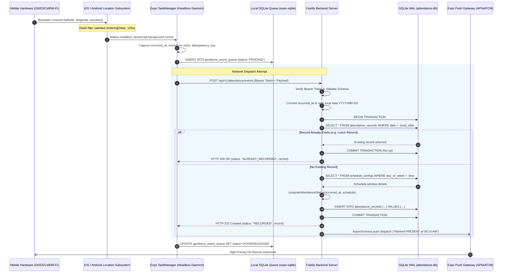
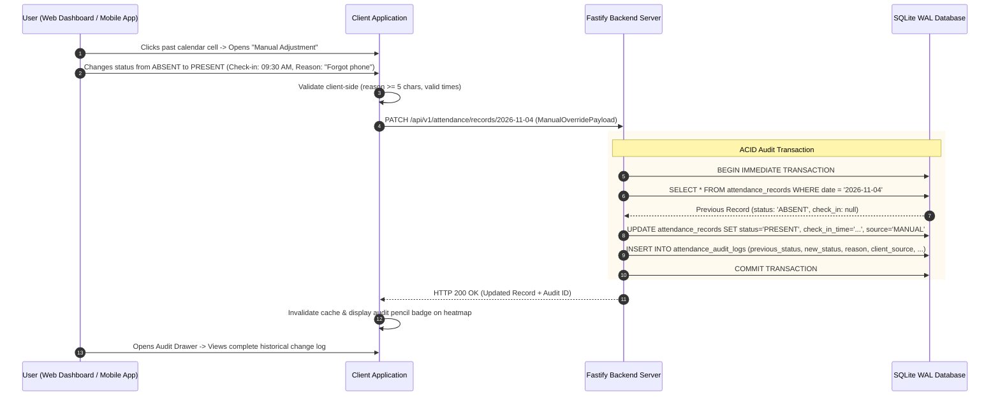
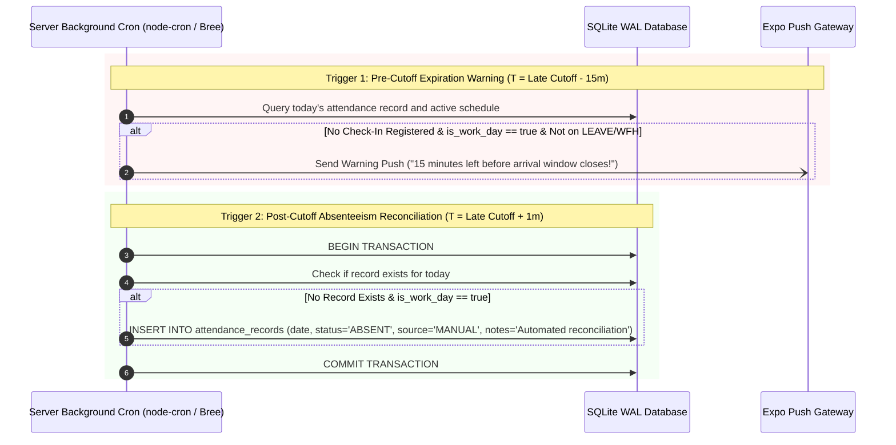

# Technical Architecture Specification

> **System**: Attendance Tracker  
> **Document Version**: 1.0.0 (Milestone 1 Authoritative Specification)  
> **Target Topology**: TypeScript Monorepo (pnpm + Turborepo), Dual Clients (Expo React Native + Vite React SPA), Fastify Server with Embedded SQLite (WAL)  

---

## 1. System Architecture & High-Level Design

### 1.1 Architectural Principles
1. **Single-User Specialization**: Engineered strictly for an individual user without multi-tenant overhead, enterprise role-based authorization hierarchies, or bulky connection pooling layers.
2. **Local-First & Embedded Durability**: SQLite in Write-Ahead Logging (WAL) mode is embedded in-process within the Fastify Node.js server. This provides ACID-compliant persistence, sub-millisecond local reads/writes, zero external database daemon dependencies, and live lock-free snapshots via `VACUUM INTO`.
3. **Hardware-Assisted Power Efficiency**: Native OS background geofencing (iOS `CLCircularRegion` and Android `GeofencingClient`) relies on cellular base station handoffs and Wi-Fi beacons, waking the application and spinning up satellite GNSS positioning only within proximate boundary zones.
4. **Idempotent Ingestion State Machine**: Boundary flutter, Wi-Fi reconnection bounces, and lunch trips do not corrupt or overwrite daily attendance. The system enforces strict database-level unique constraints and atomic upsert state evaluation.
5. **Universal End-to-End Type Safety**: A single shared contract package (`packages/shared`) provides single-source-of-truth Zod validation schemas and TypeScript types directly consumed by the backend server, mobile client, and web portal.

### 1.2 Component Interaction Diagram

```mermaid
flowchart TD
    subgraph MobileDevice["Mobile Client (Expo SDK 51+ / React Native)"]
        direction TB
        subgraph NativeOS["Native OS Location Subsystem"]
            iOS_CL["iOS CoreLocation (CLCircularRegion)"]
            Android_GM["Android GeofencingClient"]
            WiFi_Mon["Wi-Fi Network State Monitor"]
        end
        
        subgraph Daemon["Headless Background Daemon"]
            TM["Expo TaskManager\n(Global Module Scope)"]
            SQLite_Q[("Local SQLite Queue\n(expo-sqlite)")]
            Dispatcher["Retry Dispatcher\n(Exp Backoff + Jitter)"]
            NetWatcher["NetInfo Reconnect Listener"]
        end
        
        iOS_CL -->|didEnterRegion| TM
        Android_GM -->|PendingIntent| TM
        WiFi_Mon -->|SSID Matched| TM
        TM -->|Persist Event (PENDING)| SQLite_Q
        SQLite_Q --> Dispatcher
        NetWatcher -->|Flush On Online| Dispatcher
    end

    subgraph ExternalNetwork["Network & Ingress Layer"]
        CF_Tunnel["Cloudflare Tunnel (cloudflared)\n[Homelab / Behind CGNAT]"]
        Caddy_Proxy["Caddy Reverse Proxy (Auto TLS)\n[VPS Deployment]"]
    end

    Dispatcher -->|POST /api/v1/attendance/events\n(Bearer API Token)| CF_Tunnel
    Dispatcher -->|POST /api/v1/attendance/events\n(Bearer API Token)| Caddy_Proxy

    subgraph BackendServer["Centralized Server Container (Fastify Node.js)"]
        direction TB
        IngressRoute["Fastify HTTP Ingress\n(/api/v1/attendance/*)"]
        AuthFilter["Auth Guard\n(Bearer Token / JWT Cookie)"]
        ZodValidator["Schema Validation\n(Ajv / Zod Parser)"]
        
        subgraph CoreEngine["Business Logic & Ingestion Engine"]
            IdempGuard["Idempotency Filter\n(user_id + local_date check)"]
            StatusCalc["Status State Machine\n(Window Start / End / Cutoff)"]
            ReconcileCron["Scheduled Cron Tasks\n(Absenteeism & Pre-Cutoff Warning)"]
        end
        
        subgraph Persistence["Storage Layer (Drizzle ORM)"]
            SQLite_Engine[("SQLite 3 Database (WAL Mode)\n/data/attendance.db")]
            Litestream["Litestream WAL Sidecar\n(Continuous Cloud Replication)"]
        end

        IngressRoute --> AuthFilter
        AuthFilter --> ZodValidator
        ZodValidator --> IdempGuard
        IdempGuard --> StatusCalc
        StatusCalc -->|ACID Transaction| SQLite_Engine
        ReconcileCron -->|Reconcile Past Cutoff| SQLite_Engine
        SQLite_Engine --> Litestream
    end

    CF_Tunnel --> IngressRoute
    Caddy_Proxy --> IngressRoute

    subgraph NotificationRelay["Push Delivery Infrastructure"]
        ExpoPush["Expo Push Service Gateway\n(exp.host/--/api/v2/push/send)"]
        APNs["Apple Push Notification service (APNs)"]
        FCM["Firebase Cloud Messaging (FCM)"]
        ntfy["ntfy / Gotify Relay (Self-Hosted Optional)"]
    end

    StatusCalc -->|Trigger Immediate Arrival Push| ExpoPush
    ReconcileCron -->|Trigger 15m Warning Alert| ExpoPush
    StatusCalc -.->|Optional Webhook| ntfy
    ExpoPush --> APNs
    ExpoPush --> FCM
    APNs -->|High-Priority Banner| MobileDevice
    FCM -->|High-Priority Banner| MobileDevice

    subgraph WebClient["Web Dashboard (React 18 + Vite SPA)"]
        WebUI["Desktop / Mobile Web Browser"]
        MapLibre["MapLibre GL Work Location Editor"]
        ScheduleUI["7-Day Schedule Matrix Editor"]
        HeatmapUI["52-Week Attendance Heatmap"]
        OverrideUI["Manual Adjustment Drawer"]
    end

    WebUI -->|Argon2id Login / JWT Session| Caddy_Proxy
    WebUI -->|Argon2id Login / JWT Session| CF_Tunnel
    Caddy_Proxy -->|Serve Static SPA Assets| WebUI
    CF_Tunnel -->|Serve Static SPA Assets| WebUI
```

---

## 2. Monorepo Structure, Tooling & Build Pipeline

The project is governed by **pnpm workspaces** and **Turborepo** to maintain modularity, strict compilation boundaries, and shared code hygiene.

### 2.1 Workspace Configuration (`pnpm-workspace.yaml`)
```yaml
packages:
  - 'apps/*'
  - 'packages/*'
```

### 2.2 Turborepo Task Pipeline (`turbo.json`)
```json
{
  "$schema": "https://turbo.build/schema.json",
  "pipeline": {
    "build": {
      "dependsOn": ["^build"],
      "outputs": ["dist/**", ".next/**"]
    },
    "type-check": {
      "dependsOn": ["^build"],
      "outputs": []
    },
    "lint": {
      "outputs": []
    },
    "test": {
      "dependsOn": ["^build"],
      "outputs": []
    },
    "dev": {
      "cache": false,
      "persistent": true
    }
  }
}
```

### 2.3 Dependency Graph
- `packages/tsconfig` $\rightarrow$ Shared by all packages and applications.
- `packages/eslint-config` $\rightarrow$ Shared by all packages and applications.
- `packages/shared` $\rightarrow$ Consumed by `packages/api-client`, `apps/server`, `apps/web`, `apps/mobile`.
- `packages/api-client` $\rightarrow$ Consumed by `apps/web` and `apps/mobile`.
- `apps/server` $\rightarrow$ Independent service container; hosts compiled `apps/web` static assets.

---

## 3. Shared Contract Package (`packages/shared`)

`packages/shared` serves as the authoritative domain kernel. It contains runtime validation schemas, derived TypeScript types, enumeration definitions, constants, and pure business logic functions.

### 3.1 Directory Topology
```text
packages/shared/
├── src/
│   ├── index.ts                 # Root barrel export
│   ├── enums/
│   │   ├── attendance-status.ts # AttendanceStatus (PRESENT, LATE, ABSENT, LEAVE, WFH)
│   │   ├── attendance-source.ts # AttendanceSource (GEOFENCE, WIFI_AUTO, MANUAL)
│   │   └── audit-action.ts      # AuditAction (CREATE, UPDATE, DELETE)
│   ├── schemas/
│   │   ├── user.ts              # UserSettingsSchema
│   │   ├── location.ts          # LocationConfigSchema
│   │   ├── schedule.ts          # ScheduleConfigSchema
│   │   ├── attendance.ts        # AttendanceRecordSchema, GeofenceCheckInSchema
│   │   └── audit.ts             # AttendanceAuditLogSchema, ManualOverrideSchema
│   ├── types/
│   │   └── index.ts             # Inferred TypeScript types (z.infer<typeof ...>)
│   ├── constants/
│   │   ├── geofence.ts          # Default radius, min/max limits (50m - 500m)
│   │   └── timing.ts            # Default reminder offset (15m), max drift (300s)
│   └── logic/
│       ├── status-calculator.ts # Pure status evaluation function
│       ├── haversine.ts         # Great-circle distance calculations
│       └── time-utils.ts        # Timezone conversion and window comparison utils
├── package.json
└── tsconfig.json
```

### 3.2 Canonical Zod Schemas & Domain Types

```typescript
// packages/shared/src/enums/attendance-status.ts
export const AttendanceStatusEnum = {
  PRESENT: 'PRESENT',
  LATE: 'LATE',
  ABSENT: 'ABSENT',
  LEAVE: 'LEAVE',
  WFH: 'WFH',
} as const;
export type AttendanceStatus = (typeof AttendanceStatusEnum)[keyof typeof AttendanceStatusEnum];

// packages/shared/src/enums/attendance-source.ts
export const AttendanceSourceEnum = {
  GEOFENCE: 'GEOFENCE',
  WIFI_AUTO: 'WIFI_AUTO',
  MANUAL: 'MANUAL',
} as const;
export type AttendanceSource = (typeof AttendanceSourceEnum)[keyof typeof AttendanceSourceEnum];

// packages/shared/src/schemas/location.ts
import { z } from 'zod';

export const LocationConfigSchema = z.object({
  id: z.string().uuid().optional(),
  name: z.string().min(1).max(100),
  latitude: z.number().min(-90).max(90),
  longitude: z.number().min(-180).max(180),
  radius_meters: z.number().int().min(50).max(500).default(100),
  wifi_ssid: z.string().max(64).nullable().optional(),
  wifi_bssid: z.string().max(32).nullable().optional(),
  is_active: z.boolean().default(true),
});
export type LocationConfig = z.infer<typeof LocationConfigSchema>;

// packages/shared/src/schemas/schedule.ts
export const TimeStringSchema = z.string().regex(/^([01]\d|2[0-3]):([0-5]\d):([0-5]\d)$/, {
  message: 'Time must be in 24-hour HH:MM:SS format',
});

export const ScheduleConfigItemSchema = z
  .object({
    id: z.string().uuid().optional(),
    day_of_week: z.number().int().min(0).max(6), // 0=Sunday, 6=Saturday
    is_work_day: z.boolean(),
    window_start: TimeStringSchema,
    window_end: TimeStringSchema,
    late_cutoff: TimeStringSchema,
  })
  .refine(
    (data) => {
      if (!data.is_work_day) return true;
      return data.window_start < data.window_end && data.window_end < data.late_cutoff;
    },
    {
      message: 'Schedule window must satisfy: window_start < window_end < late_cutoff',
      path: ['window_end'],
    }
  );
export type ScheduleConfigItem = z.infer<typeof ScheduleConfigItemSchema>;

// packages/shared/src/schemas/attendance.ts
export const GeofenceCheckInSchema = z.object({
  event_id: z.string().uuid().optional(), // UUIDv4 idempotency key (alias: idempotency_key)
  idempotency_key: z.string().uuid().optional(),
  user_id: z.string().uuid().optional(),
  event_type: z.enum(['ENTER', 'EXIT', 'DWELL']).default('ENTER'),
  occurred_at: z.string().datetime(), // ISO 8601 UTC
  source: z.enum(['GEOFENCE', 'WIFI_AUTO', 'MANUAL']),
  latitude: z.number().min(-90).max(90).optional(),
  longitude: z.number().min(-180).max(180).optional(),
  accuracy_meters: z.number().min(0).max(1000).optional(),
  client_dispatch_time: z.string().datetime().optional(),
  wifi_ssid: z.string().max(64).optional(),
  wifi_bssid: z.string().max(32).optional(),
  device_id: z.string().max(128).optional(),
  monotonic_timestamp_ms: z.number().int().positive().optional(),
});
export type GeofenceCheckIn = z.infer<typeof GeofenceCheckInSchema>;

export const AttendanceRecordSchema = z.object({
  id: z.string().uuid(),
  user_id: z.string().uuid(),
  date: z.string().regex(/^\d{4}-\d{2}-\d{2}$/), // Local calendar date YYYY-MM-DD
  check_in_time: z.string().datetime().nullable(),
  check_out_time: z.string().datetime().nullable(),
  status: z.enum(['PRESENT', 'LATE', 'ABSENT', 'LEAVE', 'WFH']),
  source: z.enum(['GEOFENCE', 'WIFI_AUTO', 'MANUAL']),
  check_in_lat: z.number().nullable().optional(),
  check_in_lng: z.number().nullable().optional(),
  accuracy_meters: z.number().nullable().optional(),
  notes: z.string().nullable().optional(),
  created_at: z.string().datetime(),
  updated_at: z.string().datetime(),
});
export type AttendanceRecord = z.infer<typeof AttendanceRecordSchema>;

export const ManualOverrideSchema = z.object({
  status: z.enum(['PRESENT', 'LATE', 'ABSENT', 'LEAVE', 'WFH']),
  check_in_time: z.string().datetime().nullable().optional(),
  check_out_time: z.string().datetime().nullable().optional(),
  reason: z.string().min(5, { message: 'A justification of at least 5 characters is required' }),
  client_source: z.enum(['WEB_PORTAL', 'MOBILE_APP']),
});
export type ManualOverride = z.infer<typeof ManualOverrideSchema>;
```

### 3.3 Status Computation Engine (`status-calculator.ts`)

```typescript
export interface StatusEvaluationInput {
  arrivalTimeLocal: string; // HH:MM:SS in user's timezone
  schedule: ScheduleConfigItem;
}

export function computeAttendanceStatus(input: StatusEvaluationInput): {
  status: AttendanceStatus;
  isEarly: boolean;
  cutoffBreached: boolean;
} {
  const { arrivalTimeLocal, schedule } = input;

  if (!schedule.is_work_day) {
    // Arrival on a non-working day is recorded as PRESENT without streak impact
    return { status: AttendanceStatusEnum.PRESENT, isEarly: false, cutoffBreached: false };
  }

  // Case 1: Early or On-Time Arrival
  if (arrivalTimeLocal <= schedule.window_end) {
    const isEarly = arrivalTimeLocal < schedule.window_start;
    return { status: AttendanceStatusEnum.PRESENT, isEarly, cutoffBreached: false };
  }

  // Case 2: Arrival during Grace Period
  if (arrivalTimeLocal <= schedule.late_cutoff) {
    return { status: AttendanceStatusEnum.LATE, isEarly: false, cutoffBreached: false };
  }

  // Case 3: Arrival Past Grace Cutoff
  return { status: AttendanceStatusEnum.LATE, isEarly: false, cutoffBreached: true };
}
```

---

## 4. End-to-End Data Flow Walkthroughs

### 4.1 Background Geofence Check-In Flow



1. **Boundary Crossing**: Device physically crosses the workplace radius. The GNSS sensor hub detects the boundary and verifies the 120-second dwell window.
2. **Headless Wakeup**: The OS executes the registered background task without launching the visual UI.
3. **Queue Durability**: The daemon saves the event to the local device SQLite queue immediately. If the device is in an underground parking structure with zero signal, the event is safe.
4. **Ingestion & Idempotency**: Fastify receives the payload. It translates the UTC timestamp to the user's localized date and checks the unique constraint `(user_id, date)`. If a record already exists, it preserves the existing check-in time and returns HTTP 200.
5. **Status Evaluation**: If no record exists, the server checks the arrival time against the day's arrival window and saves the `attendance_records` row inside an ACID transaction.
6. **Push Notification**: An asynchronous job triggers the Expo Push API, delivering a notification to the user's lock screen.

### 4.2 Wi-Fi Fallback Check-In Flow

```mermaid
sequenceDiagram
    autonumber
    participant Phone as Mobile Device Wi-Fi Hardware
    participant Watcher as NetInfo / Network Broadcast Receiver
    participant TM as Expo TaskManager
    participant Server as Fastify Backend Server
    participant DB as SQLite WAL

    Phone->>Phone: Device enters office building; connects to "Office-Secure-5G"
    Watcher->>TM: Network state change event (SSID: "Office-Secure-5G", BSSID: "00:14:22:01:23:45")
    TM->>TM: Compare connected SSID against cached location_configs
    Note over TM: Match confirmed!
    TM->>Server: POST /api/v1/attendance/events (source: "WIFI_AUTO", wifi_ssid, wifi_bssid)
    Server->>Server: Validate SSID against active location_configs
    Server->>DB: Atomic Upsert (Preserves check-in if already registered)
    DB-->>Server: Success
    Server-->>TM: HTTP 200 / 201 Response
```

1. **Network Trigger**: As the user steps into a basement office with no GPS coverage, their phone joins the saved corporate Wi-Fi.
2. **SSID Evaluation**: The background network listener inspects the SSID. If it matches `location_configs.wifi_ssid`, it triggers the check-in pipeline with `source: WIFI_AUTO`.
3. **Server Validation**: The server confirms that the SSID is configured and active, marks attendance, and guarantees idempotency.

### 4.3 Manual Adjustment & Audit Trail Flow



1. **Client Intent**: User identifies a day where attendance was missed or misclassified.
2. **Mandatory Justification**: The form strictly rejects empty reasons, requiring at least 5 descriptive characters.
3. **Atomic Audit Insertion**: Inside a single SQLite write transaction, the server reads previous values, updates `attendance_records`, and appends an immutable row to `attendance_audit_logs`.
4. **Visual Indicator**: The UI renders a dedicated audit pencil badge on the calendar heatmap, and the change log is viewable in the audit drawer.

### 4.4 Scheduled Reconciliation Flow



---

## 5. Database Architecture & Schema Specification

The database is powered by embedded **SQLite 3** operating in **Write-Ahead Logging (WAL)** mode via `better-sqlite3` and managed through **Drizzle ORM**.

### 5.1 SQLite Pragma Initialization
Upon server boot, before handling HTTP requests, Fastify executes the following performance and integrity pragmas:
```sql
PRAGMA journal_mode = WAL;          -- Concurrent reads while writing
PRAGMA synchronous = NORMAL;        -- Resilient disk flushing with high throughput
PRAGMA foreign_keys = ON;           -- Enforce relational foreign keys
PRAGMA busy_timeout = 5000;         -- 5-second queue wait avoids SQLITE_BUSY
PRAGMA cache_size = -20000;         -- 20 MB in-memory cache
PRAGMA temp_store = MEMORY;         -- Temp tables and indices allocated in RAM
```

### 5.2 Complete Database DDL Schema

```sql
-- 1. User Settings Table
CREATE TABLE IF NOT EXISTS user_settings (
    id TEXT PRIMARY KEY NOT NULL,                -- UUIDv4
    user_id TEXT UNIQUE NOT NULL,               -- Subject / Single-User Key
    display_name TEXT NOT NULL,
    timezone TEXT NOT NULL DEFAULT 'UTC',       -- IANA Timezone (e.g. 'Asia/Kolkata')
    notifications_enabled INTEGER NOT NULL DEFAULT 1, -- Boolean
    reminder_minutes_before_cutoff INTEGER NOT NULL DEFAULT 15,
    created_at TEXT NOT NULL DEFAULT (strftime('%Y-%m-%dT%H:%M:%fZ', 'now')),
    updated_at TEXT NOT NULL DEFAULT (strftime('%Y-%m-%dT%H:%M:%fZ', 'now'))
);

-- 2. Location Configurations Table
CREATE TABLE IF NOT EXISTS location_configs (
    id TEXT PRIMARY KEY NOT NULL,                -- UUIDv4
    user_id TEXT NOT NULL,
    name TEXT NOT NULL,
    latitude REAL NOT NULL,
    longitude REAL NOT NULL,
    radius_meters INTEGER NOT NULL DEFAULT 100 CHECK(radius_meters BETWEEN 50 AND 500),
    wifi_ssid TEXT,
    wifi_bssid TEXT,
    is_active INTEGER NOT NULL DEFAULT 1,       -- Boolean
    created_at TEXT NOT NULL DEFAULT (strftime('%Y-%m-%dT%H:%M:%fZ', 'now')),
    updated_at TEXT NOT NULL DEFAULT (strftime('%Y-%m-%dT%H:%M:%fZ', 'now')),
    FOREIGN KEY (user_id) REFERENCES user_settings(id) ON DELETE CASCADE
);

-- 3. Schedule Configurations Table
CREATE TABLE IF NOT EXISTS schedule_configs (
    id TEXT PRIMARY KEY NOT NULL,                -- UUIDv4
    user_id TEXT NOT NULL,
    day_of_week INTEGER NOT NULL CHECK(day_of_week BETWEEN 0 AND 6), -- 0=Sun, 6=Sat
    is_work_day INTEGER NOT NULL DEFAULT 1,     -- Boolean
    window_start TEXT NOT NULL,                  -- '09:00:00'
    window_end TEXT NOT NULL,                    -- '10:00:00'
    late_cutoff TEXT NOT NULL,                   -- '11:30:00'
    created_at TEXT NOT NULL DEFAULT (strftime('%Y-%m-%dT%H:%M:%fZ', 'now')),
    updated_at TEXT NOT NULL DEFAULT (strftime('%Y-%m-%dT%H:%M:%fZ', 'now')),
    UNIQUE (user_id, day_of_week),
    FOREIGN KEY (user_id) REFERENCES user_settings(id) ON DELETE CASCADE
);

-- 4. Attendance Records Table
CREATE TABLE IF NOT EXISTS attendance_records (
    id TEXT PRIMARY KEY NOT NULL,                -- UUIDv4
    user_id TEXT NOT NULL,
    date TEXT NOT NULL,                          -- YYYY-MM-DD (User local calendar date)
    status TEXT NOT NULL CHECK(status IN ('PRESENT', 'LATE', 'ABSENT', 'LEAVE', 'WFH')),
    source TEXT NOT NULL CHECK(source IN ('GEOFENCE', 'WIFI_AUTO', 'MANUAL')),
    check_in_time TEXT,                          -- ISO 8601 UTC timestamp
    check_out_time TEXT,                         -- ISO 8601 UTC timestamp
    check_in_lat REAL,
    check_in_lng REAL,
    accuracy_meters REAL,
    device_id TEXT,
    notes TEXT,
    created_at TEXT NOT NULL DEFAULT (strftime('%Y-%m-%dT%H:%M:%fZ', 'now')),
    updated_at TEXT NOT NULL DEFAULT (strftime('%Y-%m-%dT%H:%M:%fZ', 'now')),
    UNIQUE (user_id, date),                      -- Guarantees check-in idempotency per day
    FOREIGN KEY (user_id) REFERENCES user_settings(id) ON DELETE CASCADE
);

-- 5. Attendance Audit Logs Table (Immutable Audit Trail)
CREATE TABLE IF NOT EXISTS attendance_audit_logs (
    id TEXT PRIMARY KEY NOT NULL,                -- UUIDv4
    attendance_record_id TEXT NOT NULL,
    user_id TEXT NOT NULL,
    action TEXT NOT NULL CHECK(action IN ('CREATE', 'UPDATE', 'DELETE')),
    previous_status TEXT,
    new_status TEXT NOT NULL,
    previous_check_in_time TEXT,
    new_check_in_time TEXT,
    previous_check_out_time TEXT,
    new_check_out_time TEXT,
    reason TEXT NOT NULL,                        -- Mandatory justification string
    client_source TEXT NOT NULL CHECK(client_source IN ('WEB_PORTAL', 'MOBILE_APP')),
    ip_address TEXT,
    user_agent TEXT,
    created_at TEXT NOT NULL DEFAULT (strftime('%Y-%m-%dT%H:%M:%fZ', 'now')),
    FOREIGN KEY (attendance_record_id) REFERENCES attendance_records(id) ON DELETE CASCADE,
    FOREIGN KEY (user_id) REFERENCES user_settings(id) ON DELETE CASCADE
);

-- 6. Push Device Tokens Table
CREATE TABLE IF NOT EXISTS push_device_tokens (
    id TEXT PRIMARY KEY NOT NULL,                -- UUIDv4
    user_id TEXT NOT NULL,
    device_token TEXT NOT NULL,
    platform TEXT NOT NULL CHECK(platform IN ('IOS', 'ANDROID')),
    is_active INTEGER NOT NULL DEFAULT 1,
    last_used_at TEXT NOT NULL DEFAULT (strftime('%Y-%m-%dT%H:%M:%fZ', 'now')),
    created_at TEXT NOT NULL DEFAULT (strftime('%Y-%m-%dT%H:%M:%fZ', 'now')),
    UNIQUE (user_id, device_token),
    FOREIGN KEY (user_id) REFERENCES user_settings(id) ON DELETE CASCADE
);

-- Indexes for Query Performance
CREATE INDEX IF NOT EXISTS idx_attendance_date ON attendance_records(date);
CREATE INDEX IF NOT EXISTS idx_attendance_user_date ON attendance_records(user_id, date);
CREATE INDEX IF NOT EXISTS idx_audit_record ON attendance_audit_logs(attendance_record_id);
```

### 5.3 Drizzle ORM TypeScript Schema Implementation
```typescript
// apps/server/src/db/schema.ts
import { sqliteTable, text, integer, real, uniqueIndex } from 'drizzle-orm/sqlite-core';
import { sql } from 'drizzle-orm';

export const userSettings = sqliteTable('user_settings', {
  id: text('id').primaryKey(),
  userId: text('user_id').notNull().unique(),
  displayName: text('display_name').notNull(),
  timezone: text('timezone').notNull().default('UTC'),
  notificationsEnabled: integer('notifications_enabled', { mode: 'boolean' }).notNull().default(true),
  reminderMinutesBeforeCutoff: integer('reminder_minutes_before_cutoff').notNull().default(15),
  createdAt: text('created_at').notNull().default(sql`(strftime('%Y-%m-%dT%H:%M:%fZ', 'now'))`),
  updatedAt: text('updated_at').notNull().default(sql`(strftime('%Y-%m-%dT%H:%M:%fZ', 'now'))`),
});

export const locationConfigs = sqliteTable('location_configs', {
  id: text('id').primaryKey(),
  userId: text('user_id').notNull().references(() => userSettings.id, { onDelete: 'cascade' }),
  name: text('name').notNull(),
  latitude: real('latitude').notNull(),
  longitude: real('longitude').notNull(),
  radiusMeters: integer('radius_meters').notNull().default(100),
  wifiSsid: text('wifi_ssid'),
  wifiBssid: text('wifi_bssid'),
  isActive: integer('is_active', { mode: 'boolean' }).notNull().default(true),
  createdAt: text('created_at').notNull().default(sql`(strftime('%Y-%m-%dT%H:%M:%fZ', 'now'))`),
  updatedAt: text('updated_at').notNull().default(sql`(strftime('%Y-%m-%dT%H:%M:%fZ', 'now'))`),
});

export const scheduleConfigs = sqliteTable('schedule_configs', {
  id: text('id').primaryKey(),
  userId: text('user_id').notNull().references(() => userSettings.id, { onDelete: 'cascade' }),
  dayOfWeek: integer('day_of_week').notNull(),
  isWorkDay: integer('is_work_day', { mode: 'boolean' }).notNull().default(true),
  windowStart: text('window_start').notNull(),
  windowEnd: text('window_end').notNull(),
  lateCutoff: text('late_cutoff').notNull(),
  createdAt: text('created_at').notNull().default(sql`(strftime('%Y-%m-%dT%H:%M:%fZ', 'now'))`),
  updatedAt: text('updated_at').notNull().default(sql`(strftime('%Y-%m-%dT%H:%M:%fZ', 'now'))`),
});

export const attendanceRecords = sqliteTable('attendance_records', {
  id: text('id').primaryKey(),
  userId: text('user_id').notNull().references(() => userSettings.id, { onDelete: 'cascade' }),
  date: text('date').notNull(),
  status: text('status', { enum: ['PRESENT', 'LATE', 'ABSENT', 'LEAVE', 'WFH'] }).notNull(),
  source: text('source', { enum: ['GEOFENCE', 'WIFI_AUTO', 'MANUAL'] }).notNull(),
  checkInTime: text('check_in_time'),
  checkOutTime: text('check_out_time'),
  checkInLat: real('check_in_lat'),
  checkInLng: real('check_in_lng'),
  accuracyMeters: real('accuracy_meters'),
  deviceId: text('device_id'),
  notes: text('notes'),
  createdAt: text('created_at').notNull().default(sql`(strftime('%Y-%m-%dT%H:%M:%fZ', 'now'))`),
  updatedAt: text('updated_at').notNull().default(sql`(strftime('%Y-%m-%dT%H:%M:%fZ', 'now'))`),
}, (table) => ({
  userDateIdx: uniqueIndex('idx_user_date').on(table.userId, table.date),
}));

export const attendanceAuditLogs = sqliteTable('attendance_audit_logs', {
  id: text('id').primaryKey(),
  attendanceRecordId: text('attendance_record_id').notNull().references(() => attendanceRecords.id, { onDelete: 'cascade' }),
  userId: text('user_id').notNull().references(() => userSettings.id, { onDelete: 'cascade' }),
  action: text('action', { enum: ['CREATE', 'UPDATE', 'DELETE'] }).notNull(),
  previousStatus: text('previous_status'),
  newStatus: text('new_status').notNull(),
  previousCheckInTime: text('previous_check_in_time'),
  newCheckInTime: text('new_check_in_time'),
  previousCheckOutTime: text('previous_check_out_time'),
  newCheckOutTime: text('new_check_out_time'),
  reason: text('reason').notNull(),
  clientSource: text('client_source', { enum: ['WEB_PORTAL', 'MOBILE_APP'] }).notNull(),
  ipAddress: text('ip_address'),
  userAgent: text('user_agent'),
  createdAt: text('created_at').notNull().default(sql`(strftime('%Y-%m-%dT%H:%M:%fZ', 'now'))`),
});

export const pushDeviceTokens = sqliteTable('push_device_tokens', {
  id: text('id').primaryKey(),
  userId: text('user_id').notNull().references(() => userSettings.id, { onDelete: 'cascade' }),
  deviceToken: text('device_token').notNull(),
  platform: text('platform', { enum: ['IOS', 'ANDROID'] }).notNull(),
  isActive: integer('is_active', { mode: 'boolean' }).notNull().default(true),
  lastUsedAt: text('last_used_at').notNull().default(sql`(strftime('%Y-%m-%dT%H:%M:%fZ', 'now'))`),
  createdAt: text('created_at').notNull().default(sql`(strftime('%Y-%m-%dT%H:%M:%fZ', 'now'))`),
}, (table) => ({
  userTokenIdx: uniqueIndex('idx_user_token').on(table.userId, table.deviceToken),
}));
```

---

## 6. Centralized Server Architecture & Fastify REST API

### 6.1 Fastify Engine & Plugins
The backend is authored in TypeScript on Node.js 20 LTS utilizing Fastify v4+. Fastify was selected over Express and NestJS due to its low memory consumption (<40MB idle), async plugin architecture, and schema-compiled serialization:
- `@fastify/cors`: Strict origin validation for web SPA.
- `@fastify/helmet`: HTTP security headers.
- `@fastify/rate-limit`: Brute-force protection on authentication endpoints.
- `@fastify/jwt`: Signing and verification of session cookies.
- `@fastify/static`: High-performance delivery of compiled `apps/web` assets in single-container mode.

### 6.2 Authoritative Endpoint Specification

| Method | Endpoint | Auth Required | Description | Status Codes |
| :--- | :--- | :--- | :--- | :--- |
| `POST` | `/api/v1/auth/login` | None | Authenticates with master password; returns JWT cookie. | `200`, `401`, `429` |
| `POST` | `/api/v1/auth/logout` | Session | Clears session cookie. | `200` |
| `GET` | `/api/v1/health` | None | Container liveness check. | `200` |
| `GET` | `/api/v1/system/status` | Token/Session | Readiness: SQLite WAL status, disk space, version. | `200`, `503` |
| `POST` | `/api/v1/attendance/events` | Token/Session | Ingests geofence or Wi-Fi arrival payload (alias: `/api/v1/attendance/check-in`). | `200`, `201`, `400`, `422` |
| `POST` | `/api/v1/attendance/check-out` | Token/Session | Records departure timestamp without altering status. | `200`, `404` |
| `GET` | `/api/v1/attendance/records` | Token/Session | Queries historical attendance within `startDate` & `endDate`. | `200`, `400` |
| `GET` | `/api/v1/attendance/records/:date` | Token/Session | Retrieves record and audit log history for a specific date. | `200`, `404` |
| `PATCH` | `/api/v1/attendance/records/:date` | Token/Session | Submits manual override with mandatory audit reason. | `200`, `400`, `422` |
| `GET` | `/api/v1/attendance/stats` | Token/Session | Computes streaks, on-time percentage, and monthly summary. | `200` |
| `GET` | `/api/v1/config/location` | Token/Session | Retrieves active workplace coordinates and geofence radius. | `200` |
| `PUT` | `/api/v1/config/location` | Token/Session | Updates geofence boundaries and Wi-Fi SSID. | `200`, `422` |
| `GET` | `/api/v1/config/schedule` | Token/Session | Retrieves 7-day schedule configuration matrix. | `200` |
| `PUT` | `/api/v1/config/schedule` | Token/Session | Updates arrival windows and active work days. | `200`, `422` |
| `POST` | `/api/v1/devices/token` | Token/Session | Registers APNs/FCM device token for push alerts. | `201`, `400` |
| `GET` | `/api/v1/export` | Token/Session | Streams database export as CSV or JSON. | `200` |
| `POST` | `/api/v1/import` | Token/Session | Restores database records from JSON backup stream. | `200`, `400` |

---

## 7. Self-Hosting, Network Exposure & Tunneling Strategy

### 7.1 Single-Container Production Strategy
To guarantee an ultra-low operational footprint, production builds compile `apps/web` into static assets, which Fastify serves directly alongside `/api/v1/*`. Total RAM consumption remains under 65 MB.

### 7.2 Homelab Deployment via Cloudflare Tunnel (CGNAT Bypass)
For homelabs lacking public IPv4 addresses:
1. `cloudflared` operates as a lightweight sidecar container in `docker-compose.yml`.
2. Establishes an outbound encrypted TLS connection to Cloudflare's edge network.
3. Mobile app pings `https://attendance.yourdomain.com/api/v1/attendance/events` over standard public HTTPS without opening router ports or using fragile dynamic DNS.
4. Cloudflare Access policies must allow API token requests on `/api/v1/attendance/*` to avoid blocking headless mobile daemons.

### 7.3 VPS Deployment via Caddy Reverse Proxy
For VPS instances with public IPv4/IPv6:
1. **Caddy** serves as the front-facing reverse proxy with automatic ACME Let's Encrypt / ZeroSSL certificate management.
2. Forwards traffic on `localhost:3000` to the attendance container with HTTP/3 support and automatic HTTP-to-HTTPS redirection.

### 7.4 Production Docker Compose (`docker/docker-compose.yml`)

```yaml
version: "3.8"

services:
  attendance-server:
    image: attendance-tracker:latest
    build:
      context: ..
      dockerfile: docker/Dockerfile
    container_name: attendance-tracker
    restart: unless-stopped
    user: "1000:1000"
    environment:
      - NODE_ENV=production
      - PORT=3000
      - HOST=0.0.0.0
      - DATABASE_PATH=/data/attendance.db
      - MASTER_PASSWORD_HASH=${MASTER_PASSWORD_HASH}
      - JWT_SECRET=${JWT_SECRET}
      - API_TOKEN=${API_TOKEN}
      - EXPO_ACCESS_TOKEN=${EXPO_ACCESS_TOKEN}
      - NTFY_URL=${NTFY_URL:-}
    volumes:
      - attendance_data:/data
      - attendance_backups:/backups
    ports:
      - "127.0.0.1:3000:3000"
    healthcheck:
      test: ["CMD", "wget", "--no-verbose", "--tries=1", "--spider", "http://localhost:3000/api/v1/health"]
      interval: 30s
      timeout: 5s
      retries: 3
      start_period: 10s
    deploy:
      resources:
        limits:
          cpus: "0.50"
          memory: 256M
        reservations:
          memory: 64M
    logging:
      driver: "json-file"
      options:
        max-size: "10m"
        max-file: "3"

  # Optional Cloudflare Tunnel Sidecar for Homelab Deployments
  # cloudflared:
  #   image: cloudflare/cloudflared:latest
  #   container_name: attendance-cloudflared
  #   restart: unless-stopped
  #   command: tunnel --no-autoupdate run
  #   environment:
  #     - TUNNEL_TOKEN=${CLOUDFLARE_TUNNEL_TOKEN}
  #   depends_on:
  #     - attendance-server

volumes:
  attendance_data:
    name: attendance_data
  attendance_backups:
    name: attendance_backups
```

---

## 8. Backup & Disaster Recovery Architecture

1. **Atomic Live Snapshots (`VACUUM INTO`)**:
   - A daily cron job at 02:00 UTC executes:
     ```sql
     PRAGMA wal_checkpoint(PASSIVE);
     VACUUM INTO '/backups/attendance_backup_YYYYMMDD.db';
     ```
   - Creates a consistent, defragmented backup file on disk without locking active readers or writers.
   - Retains 30 daily, 12 weekly, and 12 monthly snapshots.
2. **Continuous Streaming via Litestream (Optional)**:
   - For real-time zero-RPO backups, Litestream replicates WAL changes directly to Cloudflare R2, AWS S3, or MinIO.
   - Restoration takes under 5 seconds: `litestream restore -o /data/attendance.db s3://bucket/attendance.db`.
3. **Complete JSON/CSV Portability**:
   - Users can download or import full portable JSON backups via Web or Mobile UI.
