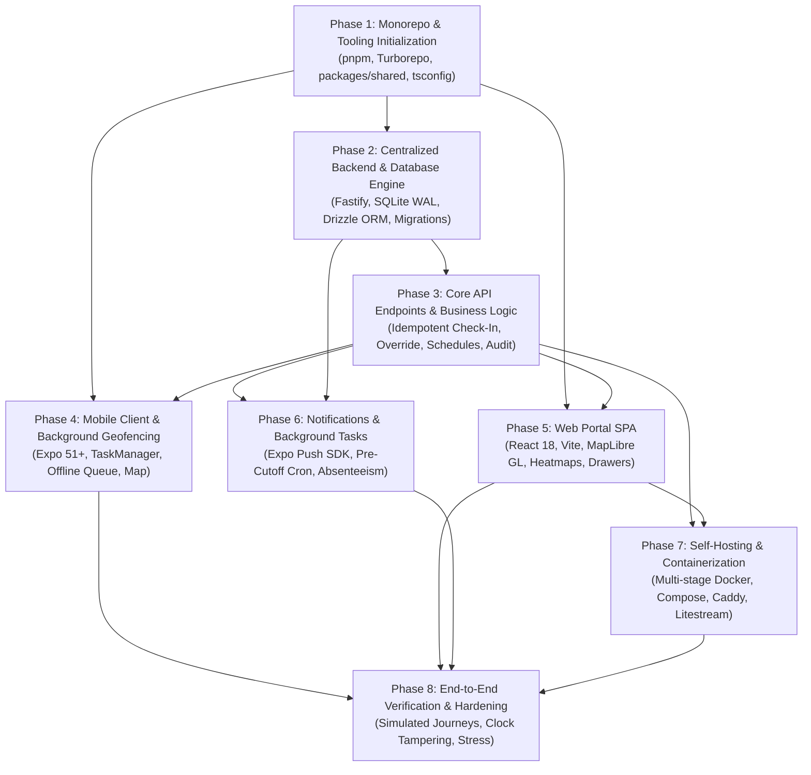

# Attendance Tracker: Engineering Implementation Roadmap

> **Document Version**: 1.0.0 (Milestone 5 Production Release)  
> **System**: Attendance Tracker Monorepo  
> **Target Topology**: TypeScript Monorepo (pnpm + Turborepo), Fastify Backend with Embedded SQLite (WAL), Dual Clients (Expo React Native Mobile + Vite React Web SPA), Docker Compose  
> **Authoritative Specification**: Conforms to `PROJECT.md`, `docs/ARCHITECTURE.md`, `docs/BACKEND_SPEC.md`, `docs/API_SPECIFICATION.md`, `docs/DATABASE_SCHEMA.md`, `docs/GEOFENCING_MECHANICS.md`, `docs/CLIENT_PARITY.md`, and `docs/SELF_HOSTING.md`.

---

## 1. Executive Roadmap Overview & Engineering Methodology

### 1.1 Purpose & Execution Model
This document provides an actionable, chronological engineering roadmap for constructing the complete **Attendance Tracker** system from scratch. Designed exclusively for a single user, the system eliminates enterprise multi-tenant overhead, connection pooling tiers, distributed message brokers, and complex role-based authorization hierarchies. Instead, it leverages:
- An ultra-fast, embedded SQLite 3 database in Write-Ahead Logging (WAL) mode managed by Drizzle ORM and `better-sqlite3`.
- A centralized Fastify Node.js 20 backend coordinating ingestion, status computation, scheduling, and notifications.
- Dual clients with 100% functional parity: a native mobile application (iOS CoreLocation and Android GeofenceManager via Expo SDK 51+) for zero-touch hardware check-ins, and a responsive web portal (Vite + React 18 + MapLibre GL) for interactive administration and analytics.
- A single-container Docker deployment model with automated TLS (Caddy) or CGNAT tunnel exposure (Cloudflare Tunnel).

The development process is structured into **8 sequential phases**, each guarded by strict entry/exit criteria and automated verification commands.

### 1.2 Phase Dependency Graph



### 1.3 Quality Gates & Engineering Standards
1. **Zero-Shortcuts Integrity**: No mock facades, hardcoded test strings, or stubbed business logic are permitted. All database transactions, coordinate math, clock skew checks, and geofence handlers must maintain genuine state.
2. **End-to-End Type Safety**: All data structures must derive from `packages/shared` Zod schemas (`z.infer<typeof ...>`). Schema drift between client and server fails build gates immediately.
3. **Strict Lint & Formatting**: ESLint 9+ flat configs and Prettier enforce clean code across all workspaces. No `any` types or disabled lint rules without written justification.
4. **Sub-65MB RAM Budget**: The backend service, embedded database, and static file server must stay under 65MB RAM under continuous load.
5. **Atomic Transactional Discipline**: All database writes involving attendance status changes, overrides, and audit logs must execute inside `BEGIN IMMEDIATE` SQLite transactions.

---

## 2. Phase 1: Monorepo & Tooling Initialization

### 2.1 Specific Objective
Establish the repository foundation using **pnpm workspaces** and **Turborepo**, standardizing TypeScript compilation, linting configurations, and building the authoritative shared kernel (`packages/shared`) containing all domain models, Zod validation schemas, constants, and pure mathematical calculation functions.

### 2.2 Deliverables
- `pnpm-workspace.yaml`: Workspace boundary definition.
- `turbo.json`: Pipeline cache definitions for `build`, `test`, `lint`, and `type-check`.
- `package.json`: Root package manifest with workspace tooling scripts.
- `packages/tsconfig/`: Shared `base.json`, `node.json`, and `react.json` TypeScript configurations.
- `packages/eslint-config/`: Unified ESLint configuration package.
- `packages/shared/`: Authoritative domain package exporting schemas, enums, interfaces, and pure functions.
- `packages/api-client/`: Typed fetch SDK wrapper scaffolding.

### 2.3 Step-by-Step Implementation Tasks
1. **Workspace & Tooling Setup**:
   - Initialize pnpm workspace root (`pnpm init`).
   - Define `pnpm-workspace.yaml` including `apps/*` and `packages/*`.
   - Install core root dev dependencies: `turbo@^2.0.0`, `typescript@^5.4.0`, `prettier@^3.2.0`, `vitest@^1.6.0`.
   - Author `turbo.json` establishing task relationships and caching outputs (`dist/**`).
2. **Compiler & Linter Configurations**:
   - Create `packages/tsconfig/base.json` with `strict: true`, `target: ES2022`, `moduleResolution: Bundler`.
   - Create `packages/tsconfig/node.json` tailored for Node 20 LTS.
   - Create `packages/tsconfig/react.json` with JSX support.
   - Configure unified ESLint configurations in `packages/eslint-config`.
3. **Authoritative Domain Enums & Schemas (`packages/shared`)**:
   - `src/enums/attendance-status.ts`: `PRESENT`, `LATE`, `ABSENT`, `LEAVE`, `WFH`.
   - `src/enums/attendance-source.ts`: `GEOFENCE`, `WIFI_AUTO`, `MANUAL`.
   - `src/enums/audit-action.ts`: `CREATE`, `UPDATE`, `DELETE`.
   - `src/schemas/location.ts`: `LocationConfigSchema` enforcing $R \in [50, 500]$ meters, latitude $[-90, 90]$, longitude $[-180, 180]$.
   - `src/schemas/schedule.ts`: `ScheduleConfigItemSchema` enforcing 24-hr `HH:MM:SS` format and the invariant:
     $$\text{window\_start} < \text{window\_end} < \text{late\_cutoff}$$
   - `src/schemas/attendance.ts`: `GeofenceCheckInSchema` (including UUIDv4 idempotency key, monotonic timestamp, coordinates) and `AttendanceRecordSchema`.
   - `src/schemas/audit.ts`: `ManualOverrideSchema` enforcing minimum 5-character reason string and `AttendanceAuditLogSchema`.
4. **Pure Mathematical & Time Logic**:
   - `src/logic/haversine.ts`: Implement great-circle distance algorithm:
     $$d = 2r \arcsin \left( \sqrt{\sin^2\left(\frac{\Delta\phi}{2}\right) + \cos(\phi_1)\cos(\phi_2)\sin^2\left(\frac{\Delta\lambda}{2}\right)} \right)$$
   - `src/logic/status-calculator.ts`: Implement `computeAttendanceStatus(arrivalTimeLocal, schedule)` handling early arrivals, window arrival, grace cutoff, and off-day rules.
   - `src/logic/time-utils.ts`: IANA timezone translation functions converting UTC timestamps to local `YYYY-MM-DD` and `HH:MM:SS`.
5. **Unit Test Suite for Shared Logic**:
   - Write comprehensive Vitest suites in `packages/shared/src/logic/status-calculator.test.ts` testing:
     - Exact window start / end boundary equality.
     - Arrival 1 millisecond before/after cutoff.
     - Non-working day arrival behavior.
     - Invalid schedule window validation rejections.

### 2.4 Acceptance / Gate Criteria
- [ ] `pnpm install` executes cleanly with locked versions in `pnpm-lock.yaml`.
- [ ] `pnpm turbo run build` compiles `packages/tsconfig` and `packages/shared` without warnings.
- [ ] `pnpm --filter @attendance/shared test` passes 100% of unit tests with $\ge 95\%$ line coverage.
- [ ] `pnpm turbo run type-check` succeeds across all workspaces.

### 2.5 Verification Commands
```bash
pnpm install --frozen-lockfile
pnpm turbo run lint
pnpm turbo run type-check
pnpm --filter @attendance/shared test --run
```

---

## 3. Phase 2: Centralized Backend & Database Engine

### 3.1 Specific Objective
Construct the Fastify backend service (`apps/server`) with native embedded SQLite 3 operating in Write-Ahead Logging (WAL) mode via `better-sqlite3` and Drizzle ORM. Implement database migrations, operational PRAGMAs, seed provisioning, and container health endpoints.

### 3.2 Deliverables
- `apps/server/package.json`: Server dependencies (`fastify`, `better-sqlite3`, `drizzle-orm`, `drizzle-kit`, `argon2`, `@fastify/jwt`, `@fastify/cookie`).
- `apps/server/src/db/client.ts`: Embedded database initialization executing the 6 mandatory SQLite PRAGMAs.
- `apps/server/src/db/schema.ts`: Complete Drizzle ORM schema models covering all 6 core tables.
- `apps/server/src/db/migrate.ts`: Programmatic startup migration runner.
- `apps/server/src/db/seed.ts`: Idempotent seed script populating default user, 7-day schedule, and geofence destination.
- `apps/server/src/app.ts`: Fastify application factory registering security plugins.
- `apps/server/src/server.ts`: Process entry point and graceful SIGTERM/SIGINT teardown.
- `GET /api/v1/health` & `GET /api/v1/system/status`: Health check routes.

### 3.3 Step-by-Step Implementation Tasks
1. **Server Workspace Scaffolding**:
   - Scaffold `apps/server` extending `packages/tsconfig/node.json`.
   - Setup Fastify v4/v5 with Pino JSON logger.
   - Configure Zod-based environment variable loader (`src/config/env.ts`) validating `DATABASE_PATH`, `PORT`, `HOST`, `JWT_SECRET`, `API_TOKEN`, `MASTER_PASSWORD_HASH`.
2. **SQLite Connection & PRAGMA Tuning (`src/db/client.ts`)**:
   - Initialize `better-sqlite3` connection against `DATABASE_PATH` (default `/data/attendance.db`).
   - Execute mandatory startup PRAGMAs immediately:
     ```sql
     PRAGMA journal_mode = WAL;
     PRAGMA synchronous = NORMAL;
     PRAGMA foreign_keys = ON;
     PRAGMA busy_timeout = 5000;
     PRAGMA cache_size = -20000;
     PRAGMA temp_store = MEMORY;
     ```
   - Bind Drizzle ORM instance (`drizzle(sqlite, { schema })`).
3. **Database Schema Definition (`src/db/schema.ts`)**:
   - Implement `userSettings` table (UUID PK, username, Argon2id hash, SHA-256 API token hash, IANA timezone).
   - Implement `locationConfigs` table (UUID PK, user FK cascade, lat/lng, radius 50–500m, wifi_ssid, wifi_bssid, is_active).
   - Implement `scheduleConfigs` table (UUID PK, user FK cascade, day_of_week 0–6, is_work_day, window_start, window_end, late_cutoff, UNIQUE `[user_id, day_of_week]`).
   - Implement `attendanceRecords` table (UUID PK, user FK cascade, date YYYY-MM-DD, status enum, source enum, check-in/out timestamps, coordinates, accuracy, notes, UNIQUE `[user_id, date]`).
   - Implement `attendanceAuditLogs` table (UUID PK, record FK cascade, previous/new status, previous/new times, mandatory reason string, client_source).
   - Implement `pushDeviceTokens` table (UUID PK, user FK cascade, token, platform iOS/Android, UNIQUE `[user_id, device_token]`).
4. **Automated Migration Runner & Seed Pipeline**:
   - Configure `drizzle.config.ts` targeting `./src/db/schema.ts` and outputting migrations to `./drizzle`.
   - Implement `src/db/migrate.ts` utilizing Drizzle's `migrate()` utility on startup before route binding.
   - Implement `src/db/seed.ts` to provision initial user (`admin`), pre-computed Argon2id hash, default Mon–Fri 09:00–10:00 schedule, and dummy headquarters coordinates if empty.
5. **Fastify Plugins & Health Endpoints**:
   - Register `@fastify/helmet`, `@fastify/cors`, `@fastify/sensible`.
   - Implement `GET /api/v1/health` returning `200 OK` with uptime, timestamp, and database connectivity.
   - Implement `GET /api/v1/system/status` inspecting SQLite `PRAGMA integrity_check`, WAL file size, and active schema version.

### 3.4 Acceptance / Gate Criteria
- [ ] Server initializes database file and successfully creates `.db-wal` and `.db-shm` files.
- [ ] `PRAGMA journal_mode` returns `wal` and foreign keys are strictly enforced.
- [ ] Automatic migrations run without manual DDL intervention.
- [ ] Seed script executes idempotently without violating unique constraints.
- [ ] `GET /api/v1/health` responds in $< 10\text{ms}$ with HTTP 200.

### 3.5 Verification Commands
```bash
pnpm --filter @attendance/server build
pnpm --filter @attendance/server test:db
curl -s http://127.0.0.1:3000/api/v1/health | grep '"status":"healthy"'
```

---

## 4. Phase 3: Core API Endpoints & Business Logic

### 4.1 Specific Objective
Implement the comprehensive REST API routing layer in Fastify, featuring dual-credential authentication (JWT cookies for Web, Bearer token for Mobile), idempotent geofence check-in ingestion, check-out tracking, schedule/location CRUD, attendance status calculation, manual overrides with immutable audit logs, and data export.

### 4.2 Deliverables
- `src/plugins/auth.ts`: Authentication pre-handler verifying Session Cookie or Bearer Token.
- `src/modules/auth/`: Login (`POST /api/v1/auth/login`), Logout (`POST /api/v1/auth/logout`), Identity (`GET /api/v1/auth/me`), Token Rotation (`POST /api/v1/auth/token/rotate`).
- `src/modules/attendance/`: Check-in (`POST /api/v1/attendance/events` & `/check-in`), Batch Replay (`POST /api/v1/attendance/events/batch`), Check-out (`POST /api/v1/attendance/check-out`), Daily Status (`GET /api/v1/attendance/today`), Range Query (`GET /api/v1/attendance/records`).
- `src/modules/override/`: Manual adjustment (`PATCH /api/v1/attendance/records/:date` & `POST /api/v1/attendance/records/override`).
- `src/modules/schedules/`: Schedule CRUD (`GET/PUT /api/v1/schedules`).
- `src/modules/locations/`: Geofence location CRUD (`GET/PUT /api/v1/locations`).
- `src/modules/analytics/`: Streaks, on-time rate, and summary metrics (`GET /api/v1/analytics/stats`).
- `src/modules/export/`: CSV and JSON historical data streaming (`GET /api/v1/attendance/export`).

### 4.3 Step-by-Step Implementation Tasks
1. **Dual-Credential Authentication Engine**:
   - Register `@fastify/jwt` and `@fastify/cookie`.
   - Implement `authGuard` hook:
     - Check `Authorization: Bearer <TOKEN>`: hash incoming token with SHA-256 and match against `user_settings.api_token_hash`.
     - Check `session_token` cookie: verify signed JWT containing `userId` payload.
     - Reject with standard RFC 9457 `401 Unauthorized` if neither credential is valid.
   - Implement `POST /api/v1/auth/login` with Argon2id password verification and rate limiting (5 req/min).
2. **Idempotent Geofence Event Ingestion**:
   - Implement `POST /api/v1/attendance/events` parsing `GeofenceCheckInSchema`.
   - **Clock Integrity Guard**: Calculate difference between device `occurred_at` and `server_time`. If $|\Delta_{\text{skew}}| > 300\text{s}$, flag record for audit review.
   - **Timezone Anchor**: Convert UTC `occurred_at` to the user's localized date (`YYYY-MM-DD`) and time (`HH:MM:SS`) using their configured IANA timezone (e.g., `Asia/Kolkata`).
   - **Transaction Isolation**: Execute inside `sqlite.transaction()` (`BEGIN IMMEDIATE`):
     - Query `attendance_records` for `(user_id, local_date)`.
     - **Idempotency Check**: If an entry record already exists for today:
       - Commit transaction without mutating initial check-in time or status.
       - Return `HTTP 200 OK` with `status: "ALREADY_RECORDED"`, the preserved record, and authoritative server time.
     - If no entry exists:
       - Query `schedule_configs` for the day of week.
       - Compute status (`computeAttendanceStatus`): `PRESENT` or `LATE`.
       - Insert into `attendance_records` with coordinates, source (`GEOFENCE` or `WIFI_AUTO`), accuracy.
       - Return `HTTP 201 Created` with `status: "RECORDED"`.
3. **Batch Offline Queue Replay**:
   - Implement `POST /api/v1/attendance/events/batch` accepting an array of geofence payloads.
   - Process events sequentially ordered by `occurred_at ASC`.
   - Enforce identical idempotency rules per item, returning individual receipt statuses (`RECORDED`, `ALREADY_RECORDED`, `SKIPPED`).
4. **Check-Out Recording Engine**:
   - Implement `POST /api/v1/attendance/check-out` ingesting exit boundary triggers.
   - Update `attendance_records.check_out_time` for the specified local date without mutating initial `check_in_time` or `status`.
5. **Manual Adjustment & Immutable Audit Trail**:
   - Implement `PATCH /api/v1/attendance/records/:date` validating `ManualOverrideSchema`.
   - Enforce mandatory `reason` string ($\ge 5$ characters).
   - In an atomic write transaction:
     - Query existing record (or create placeholder if correcting an unrecorded past date).
     - Update record status, check-in, and check-out times; set `source = 'MANUAL'`.
     - Insert row into `attendance_audit_logs` storing previous values, new values, reason, timestamp, client IP, and `client_source` (`WEB_PORTAL` or `MOBILE_APP`).
6. **Schedule & Location Configuration Endpoints**:
   - Implement `GET/PUT /api/v1/schedules` enforcing `window_start < window_end < late_cutoff` on all active days.
   - Implement `GET/PUT /api/v1/locations` enforcing radius between 50m and 500m.
7. **Analytics & Data Export**:
   - Implement `GET /api/v1/analytics/stats` computing current streak, longest streak, on-time percentage, and average arrival time.
   - Implement `GET /api/v1/attendance/export` supporting `format=json` and `format=csv`.

### 4.4 Acceptance / Gate Criteria
- [ ] Duplicate check-ins on the same calendar day return HTTP 200 without mutating original check-in timestamp or status.
- [ ] Device clock skew $> 300\text{s}$ flags the record.
- [ ] Manual override strictly requires $\ge 5$ characters and atomically creates an immutable audit row.
- [ ] Schedule updates reject invalid time windows with HTTP 422 Problem Details.
- [ ] All endpoints enforce rate limits and require valid authentication.

### 4.5 Verification Commands
```bash
pnpm --filter @attendance/server test:routes
pnpm --filter @attendance/server test:idempotency
pnpm --filter @attendance/server test:audit
```

---

## 5. Phase 4: Mobile Client & Native Background Geofencing

### 5.1 Specific Objective
Construct the React Native mobile application (`apps/mobile`) using Expo SDK 51+ (Custom Development Client). Implement native background boundary surveillance via `expo-location` and `expo-task-manager` registered in `index.js`, durable local SQLite queue via `expo-sqlite`, exponential backoff retry dispatcher, Wi-Fi SSID fallback listener, interactive map UI (`react-native-maps`), and complete client parity screens.

### 5.2 Deliverables
- `apps/mobile/package.json`: Dependencies (`expo`, `expo-location`, `expo-task-manager`, `expo-sqlite`, `expo-notifications`, `react-native-maps`, `@react-native-community/netinfo`, `expo-secure-store`).
- `apps/mobile/index.js`: Headless task declaration registered in global module scope.
- `apps/mobile/src/services/geofence-task.ts`: Background task definition handling native boundary transitions.
- `apps/mobile/src/services/offline-queue.ts`: Local SQLite durability queue (`geofence_event_queue`).
- `apps/mobile/src/services/retry-dispatcher.ts`: Exponential backoff dispatcher with jitter and `NetInfo` trigger.
- `apps/mobile/src/services/wifi-monitor.ts`: Network change listener evaluating configured `wifi_ssid`.
- `apps/mobile/src/screens/`: Parity screens:
  - `HomeScreen`: Status card, sync pill, daily metrics.
  - `MapScreen`: `react-native-maps` circular boundary visualizer, draggable pin, radius slider.
  - `ScheduleScreen`: 7-day schedule matrix with native time pickers and "Copy to Weekdays".
  - `HeatmapScreen`: 52-week horizontal grid and monthly calendar.
  - `HistoryScreen`: Day detail bottom sheet and manual adjustment form.

### 5.3 Step-by-Step Implementation Tasks
1. **Expo SDK 51+ Custom Dev Client Setup**:
   - Initialize `apps/mobile` configuring custom native plugins in `app.json`.
   - Declare iOS background capabilities: `location`, `fetch`, `processing`.
   - Declare Android permissions: `ACCESS_FINE_LOCATION`, `ACCESS_BACKGROUND_LOCATION`, `ACCESS_WIFI_STATE`, `RECEIVE_BOOT_COMPLETED`.
   - Configure iOS permission justification strings (`NSLocationAlwaysAndWhenInUseUsageDescription`, `NSLocationTemporaryUsageDescriptionDictionary`).
2. **Global Background Task Registration (`index.js`)**:
   - Declare `TaskManager.defineTask(GEOFENCE_TASK_NAME, geofenceTaskHandler)` in `index.js` before `registerRootComponent`.
   - Intercept `Location.GeofencingEventType.Enter` and `Location.GeofencingEventType.Exit`.
   - Capture device telemetry: UTC ISO timestamp, monotonic uptime (`SystemClock.elapsedRealtime()`), accuracy, coordinate payload, UUIDv4 `idempotency_key`.
3. **Local SQLite Durability Queue (`src/services/offline-queue.ts`)**:
   - Initialize `expo-sqlite` database (`offline_events.db`).
   - Create table `geofence_event_queue`:
     ```sql
     CREATE TABLE IF NOT EXISTS geofence_event_queue (
       id TEXT PRIMARY KEY,
       idempotency_key TEXT UNIQUE NOT NULL,
       event_type TEXT NOT NULL,
       payload TEXT NOT NULL,
       status TEXT NOT NULL DEFAULT 'PENDING',
       retry_count INTEGER NOT NULL DEFAULT 0,
       last_attempt_at TEXT,
       error_log TEXT,
       created_at TEXT NOT NULL
     );
     ```
   - Persist every boundary transition to local SQLite *immediately* upon receipt.
4. **Retry Dispatcher with Exponential Backoff & Jitter**:
   - Implement queue drain engine attempting network transmission via `packages/api-client`.
   - Calculate retry delay on network failure:
     $$t = \min\left(300, 2 \times 2^{\text{retry\_count}}\right) \pm \text{jitter}$$
   - Move to `DEAD_LETTER` after 10 consecutive failures.
   - Listen to `@react-native-community/netinfo`: trigger instant queue drain when transitioning from offline to online.
5. **Secondary Wi-Fi SSID Fallback Monitor**:
   - Monitor Wi-Fi state changes. If SSID matches `location_configs.wifi_ssid`, generate synthetic arrival event with `source = 'WIFI_AUTO'`.
6. **Mobile Parity UI Screens**:
   - Build interactive map screen using `react-native-maps` rendering a semi-transparent circular polygon (`strokeColor: #2563EB`, `fillColor: rgba(37, 99, 235, 0.20)`).
   - Implement radius slider (50–500m) with urban jitter warning banner below 100m.
   - Build schedule editor with native time pickers and "Copy Monday to Weekdays" shortcut.
   - Build horizontally scrollable 52-week activity heatmap and monthly calendar with status badges.
   - Build manual adjustment bottom sheet with mandatory 5-character reason validation.
   - Build real-time status card with dynamic sync pill (Green = Synced, Amber = Offline Queued, Red = Error).

### 5.4 Acceptance / Gate Criteria
- [ ] `TaskManager.defineTask` wakes in background upon simulated boundary crossing with zero visual UI rendered.
- [ ] Events captured in offline flight mode persist across device reboots in `expo-sqlite`.
- [ ] Queue drains automatically with zero data loss upon network reconnection.
- [ ] Monotonic clock and GPS epoch timestamps are transmitted with payload.
- [ ] 24-hour battery consumption is measured at $< 1.5\%$ on physical test device.

### 5.5 Verification Commands
```bash
pnpm --filter @attendance/mobile lint
pnpm --filter @attendance/mobile type-check
pnpm --filter @attendance/mobile test
# Native Dev Build execution:
pnpm --filter @attendance/mobile ios --device
pnpm --filter @attendance/mobile android --device
```

---

## 6. Phase 5: Web Portal

### 6.1 Specific Objective
Construct the responsive desktop and mobile Web Portal (`apps/web`) using React 18, Vite, and Tailwind CSS. Implement interactive MapLibre GL geofence destination configuration, 7-day schedule window matrix editor with "Copy to Weekdays", 52-week GitHub-style activity contribution grid, monthly calendar heatmap, manual override modal with immutable audit drawer, and live status header widget.

### 6.2 Deliverables
- `apps/web/package.json`: Dependencies (`react`, `react-dom`, `vite`, `tailwindcss`, `maplibre-gl`, `lucide-react`, `@attendance/shared`, `@attendance/api-client`).
- `src/components/map/GeofenceMap.tsx`: MapLibre GL map component with OpenStreetMap vector tiles, draggable marker, circular boundary GeoJSON polygon layer, and radius slider.
- `src/components/schedule/ScheduleMatrix.tsx`: 7-day schedule configuration table with inline validation.
- `src/components/heatmap/ActivityHeatmap.tsx`: 52-week GitHub-style grid and monthly calendar matrix.
- `src/components/records/DayDetailModal.tsx`: Day detail inspection modal and manual adjustment form.
- `src/components/audit/AuditHistoryDrawer.tsx`: Slide-out audit log viewer.
- `src/components/status/StatusBanner.tsx`: Live daily status badge with connectivity sync pill.
- `apps/web/dist/`: Production SPA asset bundle served directly by Fastify.

### 6.3 Step-by-Step Implementation Tasks
1. **Web Workspace Scaffolding**:
   - Initialize Vite + React 18 SPA with TypeScript and Tailwind CSS.
   - Configure path aliases and consume `@attendance/shared` directly.
   - Implement authentication wrapper handling session cookie state and redirection.
2. **Interactive MapLibre GL Geofence Visualizer**:
   - Embed MapLibre GL using free OpenStreetMap vector tiles (zero external API keys required).
   - Implement pin placement via mouse click or drag.
   - Implement address forward geocoding search input (via OpenStreetMap Nominatim).
   - Bind HTML range slider to `radius_meters` (50–500m in 10m steps).
   - Dynamically render GeoJSON circle polygon layer using 64-vertex trigonometry:
     $$\text{coord}_i = \left( \text{lon} + \frac{R \cos\theta_i}{\cos(\text{lat}) \cdot 111320}, \, \text{lat} + \frac{R \sin\theta_i}{110540} \right)$$
   - Render amber callout warning if radius $< 100\text{m}$.
   - Provide manual coordinate input fallback if WebGL fails.
3. **Schedule Window Matrix Editor**:
   - Render 7-day Monday through Sunday table.
   - Enforce client-side validation: $\text{window\_start} < \text{window\_end} < \text{late\_cutoff}$.
   - Add "Copy Monday to Weekdays" shortcut button.
   - Highlight invalid inputs with red borders and inline explanation messages; disable submit button during invalid states.
4. **Attendance Calendar Heatmap & 52-Week Grid**:
   - Render monthly calendar grid with localized day headers.
   - Render 52-week horizontal activity contribution grid.
   - Apply canonical status color tokens:
     - `PRESENT`: Emerald (`#10B981`)
     - `LATE`: Amber (`#F59E0B`)
     - `ABSENT`: Red (`#EF4444`)
     - `LEAVE`: Blue (`#3B82F6`)
     - `WFH`: Purple (`#8B5CF6`)
     - `OFF_DAY`: Muted Zinc (`#3F3F46`)
   - Display pencil icon badge (✏️) on days modified via manual override.
5. **Day Detail Modal & Manual Override Drawer**:
   - Clicking any day opens the Day Detail modal displaying arrival time, departure time, total duration, coordinates, accuracy, and source badge.
   - "Adjust Record" button opens manual adjustment form:
     - Select target status (`PRESENT`, `LATE`, `ABSENT`, `LEAVE`, `WFH`).
     - Input arrival and exit times.
     - Mandatory reason textarea enforcing $\ge 5$ characters with live character counter.
   - Audit trail button opens side drawer fetching historical modifications from `attendance_audit_logs`.
6. **Live Attendance Status Widget**:
   - Top header banner rendering the 6 dynamic states (`AWAITING_WINDOW`, `WINDOW_OPEN`, `PRESENT`, `LATE`, `WINDOW_MISSED`, `ON_LEAVE`).
   - Connectivity sync pill displaying backend sync status.
7. **Production Build & Integration**:
   - Configure `vite.config.ts` to output optimized static bundle to `apps/web/dist`.
   - Verify Fastify `@fastify/static` plugin serves `apps/web/dist` on `/*` with index fallback.

### 6.4 Acceptance / Gate Criteria
- [ ] `pnpm --filter @attendance/web build` outputs clean static bundle without chunks exceeding size limits.
- [ ] MapLibre GL renders vector tiles, marker, and radius polygon without console errors.
- [ ] Schedule editor blocks saving when `window_end >= late_cutoff`.
- [ ] Heatmap displays identical status colors and audit badges matching `CLIENT_PARITY.md`.
- [ ] Responsive design functions seamlessly from mobile screen (375px) to 4K monitor.

### 6.5 Verification Commands
```bash
pnpm --filter @attendance/web build
pnpm --filter @attendance/web test
pnpm --filter @attendance/web type-check
```

---

## 7. Phase 6: Push Notifications & Scheduled Background Tasks

### 7.1 Specific Objective
Implement automated background cron jobs and push notification delivery via Expo Push SDK and optional self-hosted `ntfy` relays, providing immediate arrival confirmations, 15-minute pre-cutoff reminders, and automated post-cutoff absenteeism reconciliation.

### 7.2 Deliverables
- `apps/server/src/services/notification.ts`: Expo Push Notification SDK integration and `ntfy` webhook dispatcher.
- `apps/server/src/jobs/scheduler.ts`: In-process Croner scheduler management.
- `apps/server/src/jobs/absentee-reconcile.ts`: Post-cutoff and midnight absence reconciliation engine.
- `apps/server/src/jobs/pre-cutoff-warning.ts`: 15-minute reminder alert dispatcher.
- `apps/server/src/jobs/backup-maintenance.ts`: Nightly WAL checkpoint and `VACUUM INTO` backup snapshot.

### 7.3 Step-by-Step Implementation Tasks
1. **Push Notification Dispatch Service**:
   - Implement `sendPushNotification(userId, message)` using `expo-server-sdk`.
   - Store and manage push tokens in `push_device_tokens` table.
   - Intercept Expo push receipt errors: if error code is `DeviceNotRegistered`, mark token `is_active = 0` to prevent dead dispatches.
   - Add secondary webhook dispatcher targeting self-hosted `ntfy` / Gotify instances if configured.
2. **Immediate Arrival Confirmation Dispatch**:
   - Wire check-in route (`POST /api/v1/attendance/events`): upon successfully computing and recording `PRESENT` or `LATE`, trigger asynchronous push dispatch:
     *"Good morning! Marked PRESENT at 09:14 AM via Geofence."*
   - Wrap dispatch in `try/catch` to guarantee notification failures never fail the primary check-in HTTP transaction.
3. **15-Minute Pre-Cutoff Warning Cron**:
   - Schedule job running every minute or at user-specific reminder intervals.
   - Calculate target warning time: $T_{\text{warn}} = \text{window\_end} - 15\text{ minutes}$ (or configurable offset).
   - Check if current day is an active work day and no check-in is registered.
   - Check if user has already been marked on `LEAVE` or `WFH`.
   - If unrecorded, dispatch high-priority warning notification:
     *"Warning: 15 minutes remaining before your arrival window closes at 10:00 AM!"*
4. **Automated Absenteeism Reconciliation**:
   - Schedule job running at $\text{late\_cutoff} + 1\text{ minute}$ and at 23:59 local time.
   - Query if an attendance record exists for today.
   - If no record exists and `is_work_day == true`:
     - Execute atomic insert into `attendance_records` setting `status = 'ABSENT'`, `source = 'MANUAL'`, and `notes = 'Automated daily reconciliation'`.
5. **Nightly Database Maintenance & Backup Snapshot**:
   - Schedule job running at 02:00 local time.
   - Execute passive WAL checkpoint: `PRAGMA wal_checkpoint(PASSIVE)`.
   - Execute zero-lock live atomic backup:
     ```sql
     VACUUM INTO '/backups/attendance_backup_YYYYMMDD.db';
     ```
   - Enforce retention policy pruning snapshots older than 30 days.

### 7.4 Acceptance / Gate Criteria
- [ ] Successful check-in dispatches confirmation push notification asynchronously within 500ms.
- [ ] Pre-cutoff warning dispatches exactly 15 minutes before window expiration if unrecorded, and is suppressed if already checked in or on leave.
- [ ] Absenteeism job accurately marks unrecorded active work days as ABSENT.
- [ ] Nightly backup produces a verified, defragmented SQLite database file without locking active connections.

### 7.5 Verification Commands
```bash
pnpm --filter @attendance/server test:jobs
pnpm --filter @attendance/server test:notifications
```

---

## 8. Phase 7: Self-Hosting, Docker Containerization & Remote Access

### 8.1 Specific Objective
Deliver production containerization and deployment pipelines for VPS and homelab environments, including multi-stage Alpine Dockerfile, profile-driven `docker-compose.yml`, automated TLS with Caddy, Cloudflare Tunnel ingress, and Litestream live WAL streaming.

### 8.2 Deliverables
- `docker/Dockerfile`: Multi-stage Alpine container build compiling shared packages, web SPA, and backend server.
- `docker-compose.yml`: Root compose configuration supporting `default`, `homelab`, `vps`, and `litestream` profiles.
- `Caddyfile`: Root Caddy reverse proxy configuration with automatic ACME Let's Encrypt TLS and HTTP/3 QUIC.
- `litestream.yml`: Root continuous S3 WAL replication configuration.
- `.env.example`: Complete environment variable template with security guidelines.

### 8.3 Step-by-Step Implementation Tasks
1. **Multi-Stage Production Dockerfile (`docker/Dockerfile`)**:
   - **Stage 1 (Base)**: `node:20-alpine`, install `libc6-compat`, `dumb-init`, `curl`, activate `pnpm`.
   - **Stage 2 (Dependencies)**: Install `python3`, `make`, `g++` to compile native bindings for `better-sqlite3`. Run `pnpm install --frozen-lockfile`.
   - **Stage 3 (Builder)**: Compile `@attendance/shared`, `@attendance/web`, and `@attendance/server`. Run `pnpm prune --prod`.
   - **Stage 4 (Runtime)**: Non-root user (`node:node` UID 1000), copy compiled `dist/` artifacts and production node_modules. Expose port 3000. Configure container health check (`curl -f http://localhost:3000/api/v1/health`).
2. **Profile-Driven Docker Compose (`docker-compose.yml`)**:
   - `attendance-tracker`: Core Fastify + Web SPA + SQLite WAL service. Mount local volumes `./data:/data` and `./backups:/backups`. Enforce memory limit `256M` and reservation `64M`.
   - `cloudflared` (Profile `homelab`): Sidecar container establishing outbound tunnel to Cloudflare Edge. Ingress route forwards traffic to `http://attendance-tracker:3000`.
   - `caddy` (Profile `vps`): Reverse proxy binding ports 80, 443, and 443/udp with automatic ACME TLS.
   - `litestream` (Profile `litestream`): Sidecar container replicating WAL changes to Cloudflare R2 / AWS S3.
3. **Caddy Reverse Proxy Configuration (`Caddyfile`)**:
   - Enforce HSTS (`Strict-Transport-Security "max-age=31536000; includeSubDomains; preload"`).
   - Configure HTTP/3 QUIC and reverse proxy to `attendance-tracker:3000`.
4. **Litestream Continuous Replication (`litestream.yml`)**:
   - Configure real-time streaming of `/data/attendance.db` to object storage with $< 1\text{s}$ Recovery Point Objective (RPO).
5. **Environment Validation & Hardening**:
   - Verify non-root file permissions on local `./data` mount (`chown -R 1000:1000 ./data`).
   - Audit `.env.example` ensuring secrets are marked mandatory (`SESSION_SECRET`, `API_BEARER_TOKEN`).

### 8.4 Acceptance / Gate Criteria
- [ ] Multi-stage Docker build succeeds with image size $< 140\text{MB}$.
- [ ] Container launches and passes internal health check in $< 15\text{ seconds}$.
- [ ] Idle memory consumption is verified below 45MB RAM; peak load below 65MB.
- [ ] Homelab profile (`--profile homelab`) boots `cloudflared` tunnel without opening host ports.
- [ ] VPS profile (`--profile vps`) boots Caddy and terminates TLS cleanly.

### 8.5 Verification Commands
```bash
docker compose build
docker compose up -d
docker compose ps
docker stats attendance-tracker --no-stream
curl -f http://127.0.0.1:3000/api/v1/health
```

---

## 9. Phase 8: End-to-End Verification & Hardening

### 9.1 Specific Objective
Execute comprehensive end-to-end integration tests, edge case simulations, fault injection, and security hardening across the entire unified system to validate client parity, idempotency, offline sync recovery, and clock tampering guards.

### 9.2 Deliverables
- `test/e2e/simulated-journey.test.ts`: Automated simulation of physical commute and boundary breach.
- `test/e2e/boundary-bounce.test.ts`: High-frequency boundary oscillation idempotency test.
- `test/e2e/offline-sync-recovery.test.ts`: Network disconnection and queue replay test.
- `test/e2e/clock-tampering.test.ts`: Device clock manipulation rejection test.
- `test/e2e/audit-immutability.test.ts`: Verification of append-only audit logs.
- `docs/VERIFICATION_REPORT.md`: Final engineering attestation report.

### 9.3 Step-by-Step Implementation Tasks
1. **Simulated Geofence Journey Test**:
   - Generate simulated GPX coordinate path transitioning from home coordinates to workplace perimeter.
   - Trigger mobile background handler; assert local SQLite insertion.
   - Dispatch payload to server; assert `attendance_records` row created with `status = 'PRESENT'`.
   - Assert push notification confirmation received.
2. **Boundary Bounce Stress Test**:
   - Simulate 10 rapid successive geofence entry and exit events within a 5-minute window (simulating parking lot jitter or lunch errand).
   - Assert that server returns `HTTP 200 ALREADY_RECORDED` on all subsequent entries.
   - Verify initial check-in timestamp and `PRESENT` status remain strictly unmodified.
   - Verify `check_out_time` is updated on exit events without altering check-in.
3. **Offline Sync & Network Partition Recovery Test**:
   - Disconnect mobile client network.
   - Trigger geofence arrival event; verify event is saved to `geofence_event_queue` with status `PENDING`.
   - Reconnect network; verify `NetInfo` event triggers retry dispatcher.
   - Assert payload is delivered to `/api/v1/attendance/events/batch` and acknowledged by server.
   - Verify queue status transitions to `ACKNOWLEDGED`.
4. **Clock Tampering & Monotonic Skew Test**:
   - Transmit arrival payload with simulated device clock manipulated 2 hours into the future.
   - Assert server detects $|\Delta_{\text{skew}}| > 300\text{s}$ and flags the record for audit review.
5. **Audit Log Immutability & Relational Integrity**:
   - Submit manual override with valid 15-character reason.
   - Verify update to `attendance_records` and simultaneous insertion into `attendance_audit_logs`.
   - Attempt direct SQL update/delete on audit logs; verify rejection or integrity violation.
6. **Security & Performance Audit**:
   - Execute OWASP security header verification (CSP, HSTS, X-Content-Type-Options).
   - Benchmark concurrent check-in throughput (target $\ge 200\text{ req/sec}$ on SQLite WAL).

### 9.4 Acceptance / Gate Criteria
- [ ] 100% of end-to-end integration test suites pass without race conditions.
- [ ] Zero duplicate check-in records or corrupted statuses under rapid boundary bounce.
- [ ] Offline queue survives application restart and replays with original sensor timestamps.
- [ ] Full compliance with all 32 feature requirements in `PROJECT.md`.

### 9.5 Verification Commands
```bash
pnpm turbo run test
pnpm test:e2e
docker compose --profile homelab config
pnpm audit --prod
```

---

## 10. Traceability Matrix: Phases to Feature Inventory

The following matrix maps all 32 domain features defined in `PROJECT.md` to their delivering engineering phase:

| Feature # | Feature Name | Primary Phase | Supporting Spec Document | Verification Target |
| :--- | :--- | :--- | :--- | :--- |
| **1** | Monorepo Structure & Tooling | **Phase 1** | `PROJECT.md`, `docs/ARCHITECTURE.md` | `pnpm turbo run build` |
| **2** | Shared Contract Package (`packages/shared`) | **Phase 1** | `docs/ARCHITECTURE.md` | `pnpm --filter @attendance/shared test` |
| **3** | Single-User Profile & Timezone Config | **Phase 2** | `docs/DATABASE_SCHEMA.md` | Drizzle migration & seed check |
| **4** | Dual-Credential Single-User Auth | **Phase 3** | `docs/BACKEND_SPEC.md`, `docs/API_SPECIFICATION.md` | Auth route unit tests |
| **5** | Work Location Setup & Forward Geocoding | **Phase 3** | `docs/API_SPECIFICATION.md` | `PUT /api/v1/locations` test |
| **6** | Secondary Wi-Fi SSID Fallback | **Phase 4** | `docs/GEOFENCING_MECHANICS.md` | Wi-Fi transition test |
| **7** | Day-of-Week Working Schedule Matrix | **Phase 3** | `docs/DATABASE_SCHEMA.md` | Schedule CRUD tests |
| **8** | Arrival Window Validation Engine | **Phase 1** | `docs/ARCHITECTURE.md` | `ScheduleConfigItemSchema` tests |
| **9** | Geofence Event Ingestion Endpoint | **Phase 3** | `docs/API_SPECIFICATION.md` | Ingestion route integration test |
| **10** | Wi-Fi Connection Trigger Ingestion | **Phase 3** | `docs/BACKEND_SPEC.md` | `source = 'WIFI_AUTO'` test |
| **11** | On-Time Status Computation (`PRESENT`) | **Phase 1 & 3** | `docs/ARCHITECTURE.md` | Pure math & route integration test |
| **12** | Late Arrival Status Computation (`LATE`) | **Phase 1 & 3** | `docs/ARCHITECTURE.md` | Grace period cutoff test |
| **13** | Automated Absenteeism Reconciliation | **Phase 6** | `docs/BACKEND_SPEC.md` | Reconcile cron unit test |
| **14** | Planned Absence Management (`LEAVE`, `WFH`) | **Phase 3** | `docs/API_SPECIFICATION.md` | Planned absence route test |
| **15** | Multi-Entry Check-In Idempotency | **Phase 3 & 8** | `docs/ARCHITECTURE.md` | Boundary bounce stress test |
| **16** | Check-Out Time Recording Engine | **Phase 3** | `docs/API_SPECIFICATION.md` | Check-out update test |
| **17** | Persistent Mobile SQLite Offline Queue | **Phase 4** | `docs/GEOFENCING_MECHANICS.md` | Offline queue persistence test |
| **18** | Exponential Backoff with Jitter | **Phase 4** | `docs/GEOFENCING_MECHANICS.md` | Retry dispatcher simulation test |
| **19** | Network Reconnect Drain Trigger | **Phase 4** | `docs/GEOFENCING_MECHANICS.md` | NetInfo reconnect trigger test |
| **20** | Monotonic Clock & Skew Verification | **Phase 3 & 8** | `docs/GEOFENCING_MECHANICS.md` | Clock tampering injection test |
| **21** | Immediate Arrival Push Notification | **Phase 6** | `docs/BACKEND_SPEC.md` | Push dispatch integration test |
| **22** | Pre-Cutoff Expiration Warning Push | **Phase 6** | `docs/BACKEND_SPEC.md` | 15-minute cron warning test |
| **23** | Push Device Token Registration | **Phase 6** | `docs/DATABASE_SCHEMA.md` | Token registration endpoint test |
| **24** | Retroactive Attendance Correction | **Phase 3** | `docs/API_SPECIFICATION.md` | Manual override test |
| **25** | Immutable Manual Override Audit Logging | **Phase 3 & 8** | `docs/DATABASE_SCHEMA.md` | Audit log immutability test |
| **26** | Interactive Geofence Destination Map | **Phase 5** | `docs/CLIENT_PARITY.md` | MapLibre component tests |
| **27** | Schedule Window Configuration UI | **Phase 5** | `docs/CLIENT_PARITY.md` | Schedule matrix UI validation test |
| **28** | Calendar Heatmap & 52-Week Grid | **Phase 5** | `docs/CLIENT_PARITY.md` | Heatmap rendering tests |
| **29** | Real-Time Attendance Status Widget | **Phase 5** | `docs/CLIENT_PARITY.md` | Status banner state test |
| **30** | Attendance Data Export & Import | **Phase 3** | `docs/API_SPECIFICATION.md` | CSV/JSON streaming test |
| **31** | Containerized Server Deployment | **Phase 7** | `docs/SELF_HOSTING.md` | Docker build & healthcheck |
| **32** | Secure Remote Tunneling Integration | **Phase 7** | `docs/SELF_HOSTING.md` | Cloudflare / Caddy ingress test |

---

## 11. Deployment & Go-Live Checklist

Before deploying the Attendance Tracker into daily operation, complete the following pre-flight verification:

1. **Environment Configuration**:
   - [ ] Copy `.env.example` to `.env` and generate cryptographically secure random secrets:
     ```bash
     openssl rand -hex 32 # For SESSION_SECRET
     openssl rand -hex 32 # For API_BEARER_TOKEN
     ```
   - [ ] Generate Argon2id master password hash using the provided CLI tool.
   - [ ] Set `DEFAULT_TIMEZONE` to your authoritative IANA timezone (e.g. `America/New_York` or `Asia/Kolkata`).
2. **Persistent Storage Permissions**:
   - [ ] Create `./data` and `./backups` directories with UID 1000 permissions:
     ```bash
     mkdir -p ./data ./backups
     sudo chown -R 1000:1000 ./data ./backups
     ```
3. **Container Launch**:
   - [ ] For VPS: Ensure DNS A/AAAA records point to public IP and run:
     ```bash
     docker compose --profile vps up -d
     ```
   - [ ] For Homelab: Populate `CLOUDFLARE_TUNNEL_TOKEN` in `.env` and run:
     ```bash
     docker compose --profile homelab up -d
     ```
4. **Mobile Client Onboarding**:
   - [ ] Install custom development build on physical mobile device.
   - [ ] Enter Server Base URL (`https://attendance.yourdomain.com`) and paste provisioned API Bearer Token.
   - [ ] Complete Apple 2-step location permission flow to grant **Always Allow** background location.
   - [ ] Disable battery optimization for the mobile application in Android Settings (if on Android).
5. **Initial Verification**:
   - [ ] Open Web Portal at `https://attendance.yourdomain.com` and log in with master password.
   - [ ] Configure workplace geofence coordinates and arrival window in the settings panel.
   - [ ] Simulate or perform initial physical arrival; confirm instant push notification and status `PRESENT` badge on web and mobile dashboards.
