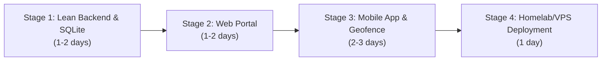

# Attendance Tracker — Simplified Single-User Plan

## 💡 Core Philosophy: Keep It Simple & Functional
This plan strips away all enterprise overhead (user registration, login/logout sessions, JWT/refresh tokens, complex microservices, multi-tenancy tables) and focuses exclusively on the single-user experience:

1. **No Auth Screens**: Since it's for one person, there are no login/signup screens. API access is secured with a single pre-shared secret token (`X-API-KEY: your-secret-token`) stored in an environment variable to prevent unauthorized public access when exposed to the internet.
2. **Minimal Database**: Exactly two SQLite tables (`settings` and `attendance_log`).
3. **Four API Endpoints**: Status, Check-in, History, and Settings.
4. **Unified Mobile & Web Experience**: Both platforms talk to the same server and display the exact same views: Today's Status, Monthly Calendar/History, and Settings.
5. **Set-and-Forget Background Geofencing**: Phone wakes up on entering work boundary -> calls `POST /api/checkin` -> done.

---

## 🏗️ Simplified Architecture

```text
┌─────────────────────────┐          ┌─────────────────────────┐
│     Mobile App (Expo)   │          │     Web Portal (React)  │
│  - Background Geofence  │          │  - Map destination      │
│  - Today's status       │          │  - Today's status       │
│  - Simple History       │          │  - Monthly calendar     │
└────────────┬────────────┘          └────────────┬────────────┘
             │                                    │
             │   HTTP / JSON (X-API-Key Header)   │
             └──────────────────┬─────────────────┘
                                │
                                ▼
               ┌──────────────────────────────────┐
               │    Centralized Server            │
               │    (Node.js Fastify / Python)    │
               │  - Simple 4-route REST API       │
               │  - Evaluates arrival time window │
               │  - SQLite Database               │
               └────────────────┬─────────────────┘
                                │
                                ▼
               ┌──────────────────────────────────┐
               │         attendance.db            │
               │  - settings                      │
               │  - attendance_log                │
               └──────────────────────────────────┘
```

---

## 📊 Minimal Data Schema (SQLite)

### 1. `settings` Table (Single Row: `id = 1`)
```sql
CREATE TABLE IF NOT EXISTS settings (
    id INTEGER PRIMARY KEY CHECK (id = 1),
    work_name TEXT DEFAULT 'Office',
    work_latitude REAL NOT NULL DEFAULT 0.0,
    work_longitude REAL NOT NULL DEFAULT 0.0,
    radius_meters INTEGER NOT NULL DEFAULT 100,
    window_start TEXT NOT NULL DEFAULT '09:00',    -- HH:MM (24h)
    window_end TEXT NOT NULL DEFAULT '10:00',      -- HH:MM (24h)
    work_days TEXT NOT NULL DEFAULT '1,2,3,4,5',    -- Mon=1 ... Fri=5
    updated_at TEXT DEFAULT CURRENT_TIMESTAMP
);
```

### 2. `attendance_log` Table
```sql
CREATE TABLE IF NOT EXISTS attendance_log (
    date TEXT PRIMARY KEY,                         -- 'YYYY-MM-DD' (ensures 1 entry/day)
    check_in_time TEXT NOT NULL,                   -- ISO8601 string or HH:MM:SS
    status TEXT NOT NULL CHECK(status IN ('PRESENT', 'LATE', 'MANUAL')),
    trigger_type TEXT DEFAULT 'GEOFENCE',          -- 'GEOFENCE' or 'MANUAL'
    latitude REAL,
    longitude REAL,
    notes TEXT
);
```

---

## 🔌 The 4 Core API Endpoints

All requests include header `X-API-Key: <SECRET_KEY>`.

### 1. `GET /api/status`
Returns today's attendance state, current settings, and the last 7 days of logs.
- **Response**:
```json
{
  "today": {
    "date": "2026-11-05",
    "checked_in": true,
    "check_in_time": "09:14:22",
    "status": "PRESENT"
  },
  "settings": {
    "work_name": "Office HQ",
    "work_latitude": 37.7749,
    "work_longitude": -122.4194,
    "radius_meters": 100,
    "window_start": "09:00",
    "window_end": "10:00",
    "work_days": [1, 2, 3, 4, 5]
  },
  "recent": [ ... ]
}
```

### 2. `POST /api/checkin`
Triggered automatically by the mobile geofence or via a manual "Check In" button.
- **Request Body**:
```json
{
  "latitude": 37.7749,
  "longitude": -122.4194,
  "trigger": "GEOFENCE" // or "MANUAL"
}
```
- **Logic**:
  - Checks if an entry already exists for today's date (`date('now')`). If yes, returns existing record (idempotent, won't duplicate).
  - Compares current time with `window_start` and `window_end`:
    - Before or within window $\rightarrow$ `status = 'PRESENT'`
    - After window $\rightarrow$ `status = 'LATE'`
  - Inserts row and returns `{ "success": true, "status": "PRESENT", "time": "09:14:22" }`.

### 3. `GET /api/history?month=YYYY-MM`
Returns records for the specified month to render the calendar view.
- **Response**: Array of `{ date, check_in_time, status, trigger_type, notes }`.

### 4. `POST /api/settings`
Updates destination coordinates, radius, or schedule window.
- **Request Body**:
```json
{
  "work_latitude": 37.7749,
  "work_longitude": -122.4194,
  "radius_meters": 150,
  "window_start": "08:30",
  "window_end": "09:45",
  "work_days": [1, 2, 3, 4, 5]
}
```

---

## 📱 Mobile & Web Client Experience (Exact Parity)

Both mobile and web share the exact same 3 screens:

### Screen 1: Dashboard (Home)
- **Big Today Banner**:
  - If checked in: Green card with `"✅ Marked Present at 09:14 AM"`.
  - If awaiting arrival: Blue card with `"⏳ Awaiting Arrival (Target: 09:00 - 10:00 AM)"`.
  - If weekend/off-day: Gray card `"🏖️ Non-working day"`.
- **Quick Action Button**: `"Manual Check In"` (in case GPS fails or phone was forgotten).
- **Recent Summary**: Mini-list of the past 5 working days.

### Screen 2: History & Calendar
- Month selector (e.g. November 2026).
- Visual calendar grid with colored dots:
  - 🟢 Green = On-time
  - 🟡 Yellow = Late
  - ⚪ Gray = Weekend / Holiday
  - 🔴 Red = Missed / Absent
- Tap any date to view exact check-in time or add a quick note.

### Screen 3: Settings
- Interactive map: Tap or drag pin to set work location.
- Slider to set radius (50m - 300m).
- Time pickers for Arrival Window Start & End.
- Checkboxes for active workdays (Mon-Fri).
- Server URL & API Key input.

---

## 🛰️ Mobile Background Geofencing (No Bloat)

Using **React Native (Expo)** with `expo-location` and `expo-task-manager`:
1. When user saves settings, app calls:
   ```javascript
   Location.startGeofencingAsync('WORK_ATTENDANCE_TASK', [
     {
       identifier: 'work-location',
       latitude: settings.work_latitude,
       longitude: settings.work_longitude,
       radius: settings.radius_meters,
       notifyOnEnter: true,
       notifyOnExit: false,
     }
   ]);
   ```
2. When OS detects entry:
   - Expo task wakes up in background.
   - Dispatches `fetch(`${SERVER_URL}/api/checkin`, { method: 'POST', headers: { 'X-API-Key': KEY } })`.
   - Triggers a local OS notification: *"You've arrived at work! Marked present."*
3. Battery impact: **Virtually 0%** extra battery drain because native OS circular regions use cell tower/Wi-Fi geofencing hardware.

---

## 🚢 Simple Homelab / VPS Deployment

A single `docker-compose.yml` runs the whole backend:

```yaml
version: '3.8'

services:
  attendance-server:
    image: node:20-alpine
    working_dir: /app
    volumes:
      - ./server:/app
      - ./data:/app/data        # Persistent SQLite storage
    environment:
      - PORT=3000
      - API_KEY=my_super_secret_key_123
      - DB_PATH=/app/data/attendance.db
    command: sh -c "npm install && npm start"
    ports:
      - "3000:3000"
    restart: unless-stopped
```

**Connecting to Internet**:
- **Homelab**: Point a free Cloudflare Tunnel (`cloudflared`) to `http://localhost:3000`. No router port forwarding required.
- **VPS**: Run Caddy or Nginx reverse proxy with automated Let's Encrypt SSL.

---

## 🗓️ Fast 4-Stage Execution Plan



1. **Stage 1: Lean Backend API & DB**
   - Create Node.js/Fastify server with SQLite.
   - Implement the 4 routes with `X-API-Key` check.
   - Verify check-in logic and idempotency with simple curl commands.
2. **Stage 2: Web Portal**
   - Clean React / Tailwind single-page app.
   - Leaflet/OpenStreetMap pin-drop for work location.
   - Dashboard card, calendar view, settings form.
3. **Stage 3: Mobile App Client**
   - Expo React Native app sharing the same screens/components.
   - Hook up `expo-location` background geofence task.
   - Test entry trigger with simulated location.
4. **Stage 4: Homelab/VPS Deployment**
   - Set up Docker container on your server.
   - Expose via Cloudflare Tunnel or VPS reverse proxy.
   - Connect mobile app and web to your live server.
